

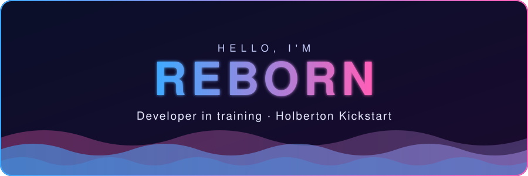

*I started out with Discord bots and small websites, and I'm now training at Holberton to go further. I'm in the **Kickstart** today, with the **Fullstack & Agentic AI** program next if I land a work-study. I care about performance, solid architecture and modern app development, with low-level foundations in C, Linux and DevOps.*

 

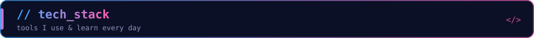

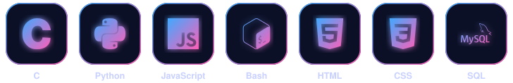

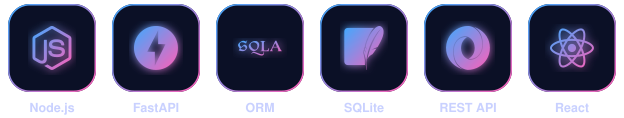

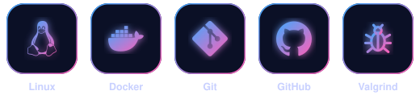

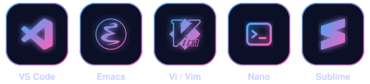

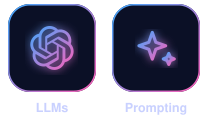

 

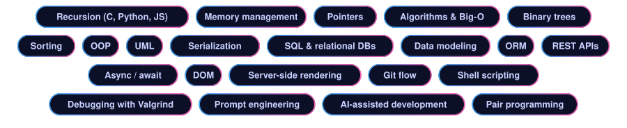

 

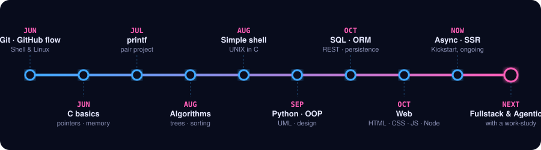

 

<h3 align="center">C & Low-level</h3>

<a href="https://github.com/RebornLPB/holbertonschool-low_level_programming">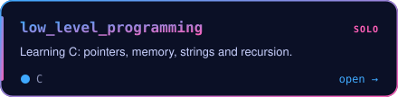</a>
<a href="https://github.com/RebornLPB/holbertonschool-printf">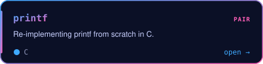</a>
<a href="https://github.com/RebornLPB/holbertonschool-simple_shell">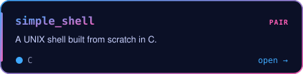</a>
<a href="https://github.com/RebornLPB/holbertonschool-binary_trees">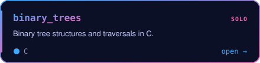</a>
<a href="https://github.com/RebornLPB/holbertonschool-sorting_algorithms">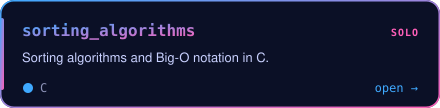</a>
<a href="https://github.com/RebornLPB/AI-Assisted-Code-Reviewer-printf-">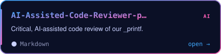</a>

<h3 align="center">Shell & Git</h3>

<a href="https://github.com/RebornLPB/holbertonschool-shell">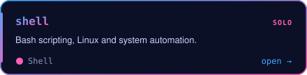</a>
<a href="https://github.com/RebornLPB/holbertonschool-github-flow">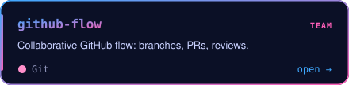</a>

<h3 align="center">Python, Design & Data</h3>

<a href="https://github.com/RebornLPB/holbertonschool-core-engineering">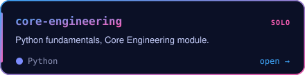</a>
<a href="https://github.com/RebornLPB/holbertonschool-higher_level_programming">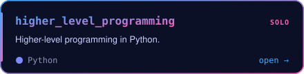</a>
<a href="https://github.com/RebornLPB/holbertonschool-sw_design_architecture">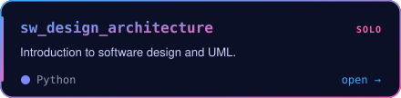</a>
<a href="https://github.com/RebornLPB/UML-Design-Lab">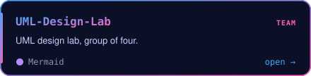</a>
<a href="https://github.com/RebornLPB/holbertonschool-data_modeling_and_persistence">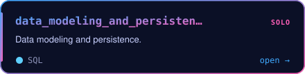</a>
<a href="https://github.com/RebornLPB/PLD-Alternative-Data-Models">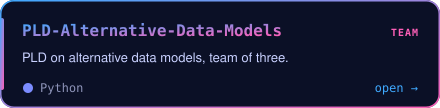</a>
<a href="https://github.com/RebornLPB/SQL-escape-game">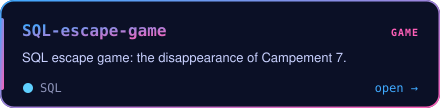</a>
<a href="https://github.com/RebornLPB/holbertonschool-interview">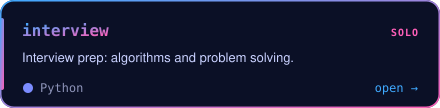</a>

<h3 align="center">Web</h3>

<a href="https://github.com/RebornLPB/holbertonschool-web_front_end">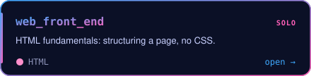</a>
<a href="https://github.com/RebornLPB/holbertonschool-web_back_end">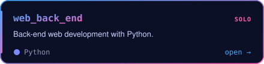</a>

 

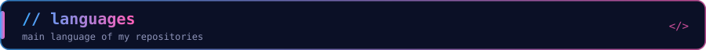

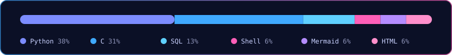

 

 

Profile config: <a href="https://github.com/RebornLPB/RebornLPB">RebornLPB/RebornLPB</a> · all repositories: <a href="https://github.com/RebornLPB?tab=repositories">see the full list</a>

